[View full-size ASCII portrait](assets/profile/avatar.svg)

  

  

### `daddyszone@github ~ $ ls projects/`

**[Scope Starter](https://daddyszone.github.io/daddyszone/)**  
A rough idea → a focused first-build brief. Runs entirely in your browser.

[Source](https://github.com/daddyszone/daddyszone/tree/main/dist) · [Project documentation](docs/scope-starter.md) · [Profile setup](docs/profile.md)

 

Small experiments. Useful tools. One commit at a time.

